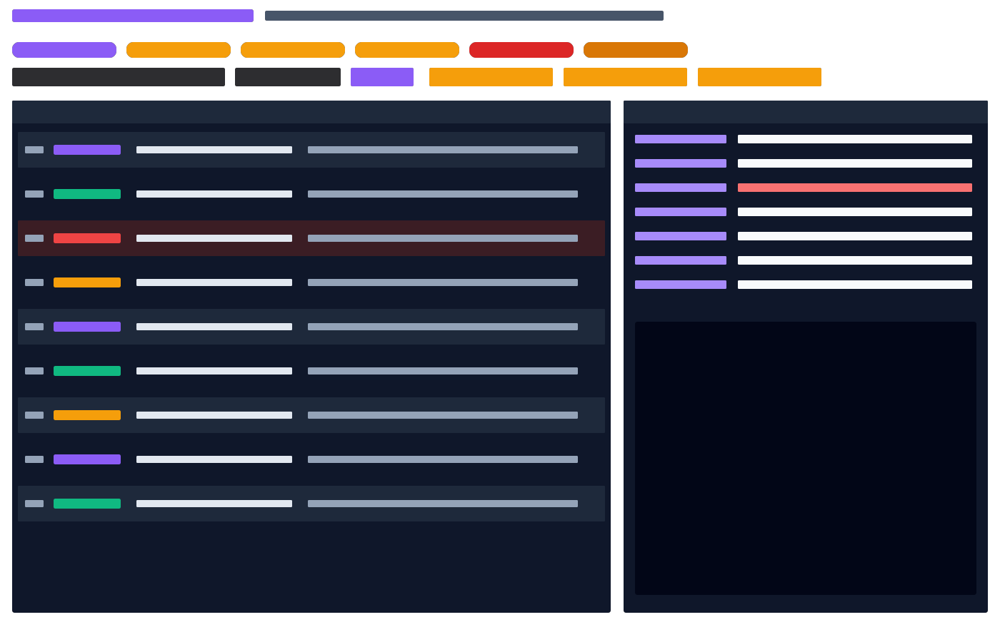

# Pulumi & AWS CDK Config Viewer for VS Code

Inspect `Pulumi.yaml`, `Pulumi.<stack>.yaml`, `cdk.json`, `cdk.context.json` and synthesized `*.template.json` CloudFormation files in VS Code without running the Pulumi CLI, AWS CDK CLI, or making any network requests. Infrastructure configs often hide plaintext passwords or API keys where a `secure:` ciphertext belongs, wildcard IAM `Action: "*"` policies, open `0.0.0.0/0` security group rules, or disabled CDK security feature flags. This extension parses Pulumi and AWS CDK files statically in plain JavaScript with zero cloud calls.

## What it opens

- `Pulumi.yaml` and `Pulumi.yml` project manifests (runtime, backend, plugins, outputs and stack references).
- `Pulumi.<stack>.yaml` and `Pulumi.<stack>.yml` stack configurations (`encryptionsalt`, `secretsprovider`, `config:` namespaces and `secure:` values).
- `cdk.json` and `cdk.context.json` app commands, watch globs, `@aws-cdk/*` feature flags and account/region context entries.
- `*.template.json` synthesized AWS CDK CloudFormation templates (resources, IAM roles, security groups, parameters and outputs).
- Any matching file via the Command Palette or Explorer context menu (Open in Pulumi & AWS CDK Config Viewer).
- Nothing to install, no Pulumi or CDK binary invoked, no cloud or network calls.

## The free part

- Config summary bar: shows format (`Pulumi Project`, `Pulumi Stack`, `AWS CDK Config`, `AWS CDK Context`, or `CDK Template`), line count, item count, stack/context count, secret/IAM count, feature-flag/output count, and static findings.
- Resources and config table: lists every Pulumi config key, CDK feature flag or CloudFormation resource with namespace or type, encryption or scope status, and finding count.
- Stacks and context view: displays Pulumi runtime, backend URL, secrets provider, and AWS CDK account/region context bindings.
- Secrets and IAM audit: separates encrypted `secure:` entries from plaintext secret-like keys, and flags wildcard IAM actions, public S3 settings, and open `0.0.0.0/0` ingress rules.
- Feature flags and outputs view: lists `@aws-cdk/*` feature flags, CloudFormation parameters/outputs, and Pulumi outputs.

## The Pro tools, with 1 free try

Pro adds the audit, diff and export steps: generate a Markdown secrets, IAM, security group and feature-flag audit for one Pulumi or CDK file or a folder, compare two Pulumi or CDK configs in Markdown, or export Markdown and CSV config and resource inventories locally. Your first try of each Pro tool is free. Zovo Pro is USD 19 once, and the team licence is USD 59.

## Why not plain text

Reading a 500-line `Pulumi.prod.yaml`, `cdk.json` or synthesized `*.template.json` in plain text makes it easy to miss an unencrypted `dbPassword`, a missing `secretsprovider`, an open port 22 CIDR, or an outdated CDK feature flag. A local visual inspector puts config keys, secrets, IAM rules, flags and findings on one screen.

## More tools by Zovo

See full docs and install options at [vscode.zovo.one/extensions/zovo-pulumi-cdk-config-viewer/](https://vscode.zovo.one/extensions/zovo-pulumi-cdk-config-viewer/), browse all Zovo VS Code extensions at [vscode.zovo.one](https://vscode.zovo.one/), or explore [Zovo Pro](https://vscode.zovo.one/pro/).
